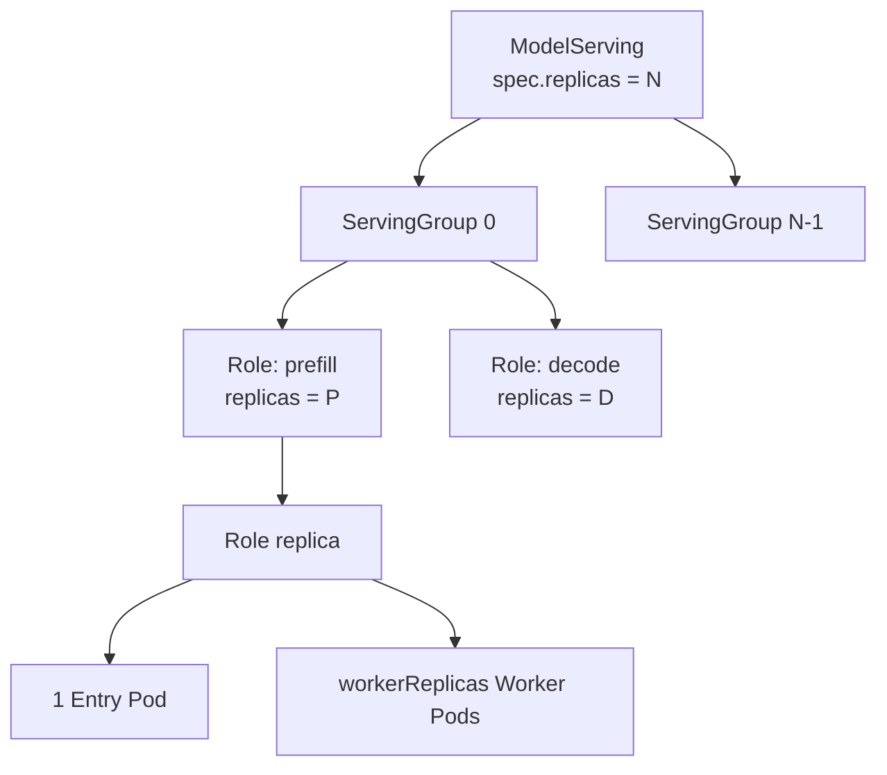

# ModelServing API 使用指南

`ModelServing` 是 Kthena 用于描述推理工作负载拓扑、Pod 模板、扩缩容方式、滚动升级策略和故障恢复策略的自定义资源。

本文面向使用 Kthena 部署推理服务的用户，重点说明：

- `ModelServing`、`ServingGroup`、`Role`、Entry Pod 和 Worker Pod 之间的关系；
- 三个副本数字段分别控制什么；
- 如何配置 Pod 模板、扩缩容、滚动升级和故障恢复；
- 如何查看 ModelServing 的运行状态。

完整的字段类型、默认值和校验规则请参见 [Workload CRD API Reference](../reference/crd/workload.serving.volcano.sh.md#modelserving)。

## 资源模型

一个 `ModelServing` 可以创建多个结构相同的 `ServingGroup`。每个 `ServingGroup` 包含一个或多个 `Role`，每个 Role 又可以包含多个 Role 实例。

每个 Role 实例固定包含：

- 一个 Entry Pod；
- 零个或多个 Worker Pod。



各层资源的职责如下：

| 层级 | 作用 |
| --- | --- |
| ModelServing | 用户直接创建的顶层资源，定义整体期望状态 |
| ServingGroup | 一套能够独立承载推理任务的 Role 组合，也是 ServingGroup 级扩缩容和滚动升级的基本单位 |
| Role | ServingGroup 中承担某类推理职责的逻辑角色，例如 `prefill`、`decode` 或 `server` |
| Role replica | 一个 Role 的独立实例，由一个 Entry Pod 和若干 Worker Pod 组成 |
| Entry Pod | Role 实例的主 Pod，每个 Role 实例固定一个 |
| Worker Pod | 与 Entry Pod 协同完成分布式推理任务的 Pod，可以不配置 |

## 理解三个副本数字段

ModelServing 中有三个作用范围不同的副本数字段。

| 字段 | 作用范围 | 含义 |
| --- | --- | --- |
| `spec.replicas` | ModelServing | ServingGroup 的数量 |
| `spec.template.roles[].replicas` | 每个 ServingGroup | 指定 Role 的实例数量 |
| `spec.template.roles[].workerReplicas` | 每个 Role 实例 | 该实例包含的 Worker Pod 数量，不包含固定存在的 Entry Pod |

Pod 总数可以按下面的公式计算：

```text
总 Pod 数 =
ModelServing replicas
× Σ(Role replicas × (1 + workerReplicas))
```

例如：

```yaml
spec:
  replicas: 2
  template:
    roles:
      - name: prefill
        replicas: 1
        workerReplicas: 3
        # entryTemplate 和 workerTemplate 省略
      - name: decode
        replicas: 2
        workerReplicas: 1
        # entryTemplate 和 workerTemplate 省略
```

每个 ServingGroup 中包含：

```text
prefill: 1 × (1 Entry + 3 Worker) = 4 Pods
decode:  2 × (1 Entry + 1 Worker) = 4 Pods
```

ModelServing 一共有两个 ServingGroup，因此总 Pod 数为：

```text
2 × (4 + 4) = 16 Pods
```

:::note
`spec.replicas` 控制的是 ServingGroup 数量，而不是 Pod 数量。
:::

## 最小配置示例

下面的配置创建两个 ServingGroup。每个 ServingGroup 中有一个 `server` Role 实例，每个 Role 实例只有一个 Entry Pod，因此最终会创建两个 Pod。

```yaml
apiVersion: workload.serving.volcano.sh/v1alpha1
kind: ModelServing
metadata:
  name: llama-server
  namespace: default
spec:
  replicas: 2
  schedulerName: volcano
  recoveryPolicy: RoleRecreate

  template:
    roles:
      - name: server
        replicas: 1
        workerReplicas: 0

        entryTemplate:
          spec:
            containers:
              - name: server
                image: example.com/llama-server:v1
                ports:
                  - name: http
                    containerPort: 8000
                resources:
                  requests:
                    cpu: "4"
                    memory: 16Gi
                    nvidia.com/gpu: "1"
                  limits:
                    cpu: "4"
                    memory: 16Gi
                    nvidia.com/gpu: "1"
```

创建并查看资源：

```bash
kubectl apply -f modelserving.yaml

kubectl get modelserving llama-server

kubectl get pods \
  -l modelserving.volcano.sh/name=llama-server
```

## ModelServing 顶层配置

`spec` 下的主要字段如下。

| 字段 | 是否必填 | 默认值 | 说明 |
| --- | --- | --- | --- |
| `replicas` | 否 | `1` | ServingGroup 数量 |
| `schedulerName` | 否 | `volcano` | 写入所创建 Pod 的 `spec.schedulerName` |
| `template` | 是 | 无 | 所有 ServingGroup 共用的模板 |
| `rolloutStrategy` | 否 | `ServingGroupRollingUpdate` | 模板更新时采用的滚动升级策略 |
| `recoveryPolicy` | 否 | `RoleRecreate` | Pod 异常或丢失后的恢复粒度 |
| `revisionHistoryLimit` | 否 | `10` | 最多保留的非活动历史 revision 数量；仍被工作负载引用的 revision 不受该上限影响 |
| `plugins` | 否 | 空 | 创建 Pod 时依次执行的插件配置 |

### 调度器

默认调度器为 Volcano：

```yaml
spec:
  schedulerName: volcano
```

如果希望使用 Kubernetes 默认调度器，可以显式配置：

```yaml
spec:
  schedulerName: default-scheduler
```

`gangPolicy` 和 `networkTopology` 依赖调度器提供对应能力。使用这些字段时，应同时使用支持相应能力的 Volcano 版本。详细配置参见：

- [Gang Scheduling](./gang-scheduling.md)
- [Network Topology](./network-topology.md)

## ServingGroup 模板

`spec.template` 定义每个 ServingGroup 的公共结构。

| 字段 | 是否必填 | 默认值 | 说明 |
| --- | --- | --- | --- |
| `roles` | 是 | 无 | ServingGroup 中包含的 Role，数量必须在 1 到 4 之间，名称不能重复 |
| `restartGracePeriodSeconds` | 否 | `0` | Controller 检测到异常后，等待多久开始执行恢复 |
| `gangPolicy` | 否 | 空 | Role 维度的 Gang 调度要求 |
| `networkTopology` | 否 | 空 | ServingGroup 和 Role 维度的网络拓扑调度要求 |

例如：

```yaml
spec:
  template:
    restartGracePeriodSeconds: 60
    roles:
      # Role 配置
```

## Role 配置

每个 `spec.template.roles[]` 元素定义一种推理角色。

| 字段 | 是否必填 | 默认值 | 说明 |
| --- | --- | --- | --- |
| `name` | 是 | 无 | Role 名称，同一个 ServingGroup 内必须唯一；建议使用小写 DNS 标签，最长 12 个字符 |
| `replicas` | 否 | `1` | 每个 ServingGroup 中该 Role 的实例数量 |
| `entryTemplate` | 是 | 无 | Entry Pod 模板 |
| `workerReplicas` | 是 | 无 | 每个 Role 实例中的 Worker Pod 数量，可以设置为 `0` |
| `workerTemplate` | 条件必填 | 无 | 当 `workerReplicas` 大于 `0` 时必须配置 |
| `maxUnavailable` | 否 | `1` | RoleRollingUpdate 时该 Role 最多允许不可用的实例数 |
| `maxSurge` | 否 | `0` | RoleRollingUpdate 时该 Role 最多允许额外创建的实例数 |
| `partition` | 否 | `0` | RoleRollingUpdate 时保留为旧版本的 Role 实例数量 |

`entryTemplate.spec` 和 `workerTemplate.spec` 使用 Kubernetes `PodSpec`，可以配置容器、资源、探针、卷、亲和性、污点容忍、`hostAliases`、`runtimeClassName` 等原生 Pod 字段。

:::warning
ModelServing 的 CRD 和 webhook 不一定覆盖 Kubernetes `PodSpec` 的全部语义校验。应确保 Pod 模板本身合法，否则 ModelServing 可能已经进入创建或滚动升级流程，但实际 Pod 创建失败。
:::

### 单 Pod Role

如果一个 Role 只需要一个 Pod，将 `workerReplicas` 设置为 `0`，不需要配置 `workerTemplate`：

```yaml
roles:
  - name: server
    replicas: 2
    workerReplicas: 0
    entryTemplate:
      spec:
        containers:
          - name: server
            image: example.com/server:v1
```

### 多 Pod Role

如果一个 Role 实例由一个主进程和多个工作进程组成，可以配置 Worker Pod：

```yaml
roles:
  - name: decode
    replicas: 2
    workerReplicas: 3

    entryTemplate:
      spec:
        containers:
          - name: leader
            image: example.com/decode:v1

    workerTemplate:
      spec:
        containers:
          - name: worker
            image: example.com/decode:v1
```

上面的配置在每个 ServingGroup 中创建两个 `decode` Role 实例，每个实例包含一个 Entry Pod 和三个 Worker Pod。

## Entry Pod 和 Worker Pod

Entry Pod 是每个 Role 实例的主 Pod，Pod 序号为 `0`；Worker Pod 的序号从 `1` 开始。

Kthena 会向 Pod 注入以下环境变量：

| 环境变量 | 含义 |
| --- | --- |
| `WORKER_INDEX` | Pod 在 Role 实例中的序号；Entry Pod 为 `0`，Worker Pod 从 `1` 开始 |
| `GROUP_SIZE` | 一个 Role 实例中的 Pod 总数，即 `1 + workerReplicas` |
| `ENTRY_ADDRESS` | Entry Pod 的访问地址，供 Worker Pod 连接主节点 |

Pod 名称通常采用下面的结构：

```text
<ModelServing>-<ServingGroup序号>-<Role名称>-<Role实例序号>-<Pod序号>
```

例如：

```text
llama-server-0-decode-1-0  # decode Role 实例1的 Entry Pod
llama-server-0-decode-1-1  # decode Role 实例1的第一个 Worker Pod
```

Role 名称可以包含连字符，因此程序不应通过简单地按 `-` 分割 Pod 名称来识别资源关系。应优先使用 Kthena 添加的标签。

## 扩缩容

ModelServing 支持 ServingGroup 和 Role 两个层级的扩缩容。

| 扩缩容层级 | 修改字段 | 行为 |
| --- | --- | --- |
| ServingGroup | `spec.replicas` | 增加或删除完整的 ServingGroup |
| Role | `spec.template.roles[].replicas` | 在每个 ServingGroup 内增加或删除指定 Role 的实例 |

### ServingGroup 扩容

将：

```yaml
spec:
  replicas: 1
```

修改为：

```yaml
spec:
  replicas: 2
```

Controller 会创建一个新的 ServingGroup，新组中包含模板定义的全部 Role。

### Role 扩容

将：

```yaml
roles:
  - name: decode
    replicas: 1
```

修改为：

```yaml
roles:
  - name: decode
    replicas: 2
```

Controller 会在每个 ServingGroup 中增加一个 `decode` Role 实例。

更多信息参见 [ModelServing Scaling](../developer-guide/model-serving-scaling.md)。

## 滚动升级

ModelServing 支持两种滚动升级粒度：

| 策略 | 更新单位 | 滚动参数配置位置 |
| --- | --- | --- |
| `ServingGroupRollingUpdate` | 整个 ServingGroup | `spec.rolloutStrategy.rollingUpdateConfiguration` |
| `RoleRollingUpdate` | 单个 Role 实例 | 对应的 `spec.template.roles[]` 内 |

### ServingGroupRollingUpdate

这是默认策略。一个 ServingGroup 中任意 Role 的 Pod 模板发生变化时，Controller 按 ServingGroup 粒度替换旧版本。

```yaml
spec:
  rolloutStrategy:
    type: ServingGroupRollingUpdate
    rollingUpdateConfiguration:
      maxUnavailable: 1
      maxSurge: 0
      partition: 0
```

### RoleRollingUpdate

该策略只替换模板发生变化的 Role，并从每个 Role 上读取滚动参数：

```yaml
spec:
  recoveryPolicy: RoleRecreate
  rolloutStrategy:
    type: RoleRollingUpdate

  template:
    roles:
      - name: prefill
        replicas: 2
        workerReplicas: 0
        maxUnavailable: 1
        maxSurge: 0
        partition: 0
        entryTemplate:
          spec:
            containers:
              - name: prefill
                image: example.com/prefill:v2
```

使用 `RoleRollingUpdate` 时需要注意：

- 不要设置 `spec.rolloutStrategy.rollingUpdateConfiguration`；
- `maxUnavailable`、`maxSurge` 和 `partition` 应配置在各 Role 下；
- 不能与 `recoveryPolicy: ServingGroupRecreate` 组合；通常应使用 `RoleRecreate`；
- Role 滚动参数会同时应用于每个 ServingGroup。当前更推荐在单个 ServingGroup 场景中使用 RoleRollingUpdate。

### 滚动参数

`maxUnavailable`、`maxSurge` 和 `partition` 都支持整数或百分比：

```yaml
maxUnavailable: 1
maxSurge: 25%
partition: 10%
```

| 参数 | 含义 | 百分比取整方式 |
| --- | --- | --- |
| `maxUnavailable` | 更新期间最多允许不可用的 ServingGroup 或 Role 实例数量 | 向下取整 |
| `maxSurge` | 更新期间允许临时超出期望副本数的 ServingGroup 或 Role 实例数量 | 向上取整 |
| `partition` | 保持旧版本、不参与本次更新的副本数量 | 向上取整 |

当仍存在可更新副本时，`maxUnavailable` 和 `maxSurge` 不能同时计算为 `0`，否则滚动升级无法开始。

`partition: N` 会保护排序靠前的 N 个现有副本。在副本序号连续时，可以理解为保留 `[0, N)` 范围内的旧版本副本。滚动升级达到 partition 边界后会停止，保留的副本不会自动更新。

更多信息参见 [ModelServing Rolling Update](../developer-guide/model-serving-rolling-update.md)。

## 故障恢复

`recoveryPolicy` 控制 Pod 异常、被删除或容器发生异常重启时的恢复范围。

| 配置值 | 行为 |
| --- | --- |
| `RoleRecreate` | 删除并重建发生异常的 Role 实例中的全部 Pod |
| `ServingGroupRecreate` | 删除并重建发生异常的整个 ServingGroup |
| `None` | 不触发额外的 Role 或 ServingGroup 整体重建；Controller 只补回缺失的单个 Pod |

推荐原则：

- 多个 Pod 必须共同初始化、必须保持同一运行代次时，选择 `ServingGroupRecreate` 或 `RoleRecreate`；
- 希望缩小故障影响范围时，选择 `RoleRecreate`；
- Pod 能够独立恢复、不需要整体重建时，可以选择 `None`。

`restartGracePeriodSeconds` 用于避免短暂异常立即触发恢复：

```yaml
spec:
  template:
    restartGracePeriodSeconds: 60
```

## Gang 调度

`gangPolicy.minRoleReplicas` 表示一个 ServingGroup 至少需要同时调度多少个指定 Role 实例。

```yaml
spec:
  schedulerName: volcano
  template:
    gangPolicy:
      minRoleReplicas:
        prefill: 1
        decode: 1
```

其中：

- Map 的 key 必须是 `roles` 中已定义的 Role 名称；
- value 不能小于 `0`，也不能大于该 Role 的 `replicas`；
- `minRoleReplicas` 创建后不可修改；
- `gangPolicy` 一旦配置，不能从 ModelServing 中删除。

如果没有显式填写 `minRoleReplicas`，所有 Role 默认都参与 Gang 调度。

详细说明参见 [Gang Scheduling](./gang-scheduling.md)。

## 网络拓扑

`networkTopology` 可以分别配置 ServingGroup 和 Role 粒度的网络拓扑约束：

```yaml
spec:
  schedulerName: volcano
  template:
    networkTopology:
      groupPolicy:
        mode: hard
        highestTierAllowed: 2
      rolePolicy:
        mode: hard
        highestTierAllowed: 1
```

- `groupPolicy` 约束同一个 ServingGroup 中的 Pod；
- `rolePolicy` 约束同一个 Role 实例中的 Pod；
- 实际可用字段和调度行为取决于 Volcano 的网络拓扑能力和集群中的 HyperNode 配置。

详细说明参见 [Network Topology](./network-topology.md)。

## 插件

`spec.plugins` 用于在 Pod 创建前执行可复用的定制逻辑。插件按列表顺序执行，后一个插件可以看到前一个插件对 Pod 的修改结果。

```yaml
spec:
  plugins:
    - name: demo-pod-tweaks
      type: BuiltIn
      scope:
        roles:
          - decode
        target: Worker
      config:
        runtimeClassName: nvidia
```

| 字段 | 说明 |
| --- | --- |
| `name` | 已注册的插件名称，同一个 ModelServing 中必须唯一 |
| `type` | 当前支持 `BuiltIn` |
| `scope.roles` | 只对指定 Role 生效；为空时对全部 Role 生效 |
| `scope.target` | `Entry`、`Worker` 或 `All`；为空时按 `All` 处理 |
| `config` | 由具体插件解析的配置对象 |

如果任意插件执行失败，Pod 不会被创建，Controller 会在后续 reconcile 中重试。

详细说明参见 [ModelServing Plugin Framework](./modelserving-plugin-framework.md)。

## 常用标签

Kthena 会为 ModelServing 创建的 Pod 添加以下标签：

| 标签 | 作用 |
| --- | --- |
| `modelserving.volcano.sh/name` | ModelServing 名称 |
| `modelserving.volcano.sh/group-name` | ServingGroup 名称 |
| `modelserving.volcano.sh/role` | Role 名称 |
| `modelserving.volcano.sh/role-id` | Role 实例标识 |
| `modelserving.volcano.sh/entry` | 是否为 Entry Pod |
| `modelserving.volcano.sh/revision` | Pod 对应的 ModelServing revision |

例如，只查看某个 ModelServing 的 Entry Pod：

```bash
kubectl get pods \
  -l 'modelserving.volcano.sh/name=llama-server,modelserving.volcano.sh/entry=true'
```

## 查看运行状态

查看 ModelServing 概览：

```bash
kubectl get modelserving
```

查看详细状态和事件：

```bash
kubectl describe modelserving llama-server
```

查看完整状态：

```bash
kubectl get modelserving llama-server -o yaml
```

主要状态字段如下：

| 字段 | 含义 |
| --- | --- |
| `status.observedGeneration` | Controller 已处理的最新 ModelServing generation |
| `status.replicas` | 已创建的 ServingGroup 数量 |
| `status.currentReplicas` | 仍处于 current revision 的 ServingGroup 数量 |
| `status.updatedReplicas` | 已达到目标 revision 的 ServingGroup 数量 |
| `status.availableReplicas` | 已 Ready 的 ServingGroup 数量 |
| `status.currentRevision` | 尚未完全退出的当前版本 |
| `status.updateRevision` | 当前 Spec 对应的目标版本 |
| `status.conditions` | ModelServing 当前的可用性、推进状态和滚动升级状态 |

常见 Condition 包括：

| Condition | 说明 |
| --- | --- |
| `Available` | ServingGroup 是否达到可用条件 |
| `Progressing` | 是否仍在创建、扩缩容或等待 Pod Ready |
| `UpdateInProgress` | 是否仍有资源需要更新到目标 revision |

判断变更是否已经被 Controller 处理时，可以先比较：

```text
metadata.generation == status.observedGeneration
```

再结合 `availableReplicas`、`updatedReplicas`、revision 和 Conditions 判断实际进展。

## 常见配置错误

### 混淆 ModelServing replicas 和 Role replicas

错误理解：

```yaml
spec:
  replicas: 4  # 误以为是创建4个Pod
```

实际含义是创建四个 ServingGroup，每个 ServingGroup 都会包含模板中的全部 Role 和 Pod。

### 配置 Worker 数量但没有 Worker 模板

下面的配置会被拒绝：

```yaml
roles:
  - name: decode
    workerReplicas: 2
    # 缺少 workerTemplate
```

当 `workerReplicas > 0` 时必须提供 `workerTemplate`。

### 把 Role 滚动参数配置在错误位置

使用 `RoleRollingUpdate` 时，下面的配置位置错误：

```yaml
rolloutStrategy:
  type: RoleRollingUpdate
  rollingUpdateConfiguration:  # 不允许
    maxUnavailable: 1
```

应将滚动参数配置到每个 Role 中。

### 使用不支持对应能力的调度器

配置 `gangPolicy` 或 `networkTopology` 时，应确认 `schedulerName` 指向支持这些能力的调度器，并确认集群已安装对应 CRD 和调度组件。

### Pod 模板配置错误

ModelServing 更新可能已经触发滚动升级，但新 Pod 因镜像、资源、卷、探针或其他 PodSpec 配置错误而无法 Ready。排查时应同时查看：

```bash
kubectl describe modelserving <name>
kubectl get events --sort-by=.lastTimestamp
kubectl describe pod <pod-name>
kubectl logs <pod-name>
```

## 完整示例和进一步阅读

- [Multi-node Inference](./multi-node-inference.md)
- [Prefill-Decode Disaggregation](./prefill-decode-disaggregation/prefill-decode-disaggregation.mdx)
- [ModelServing Scaling](../developer-guide/model-serving-scaling.md)
- [ModelServing Rolling Update](../developer-guide/model-serving-rolling-update.md)
- [Gang Scheduling](./gang-scheduling.md)
- [Network Topology](./network-topology.md)
- [ModelServing Plugin Framework](./modelserving-plugin-framework.md)
- [完整 Workload CRD API Reference](../reference/crd/workload.serving.volcano.sh.md#modelserving)
