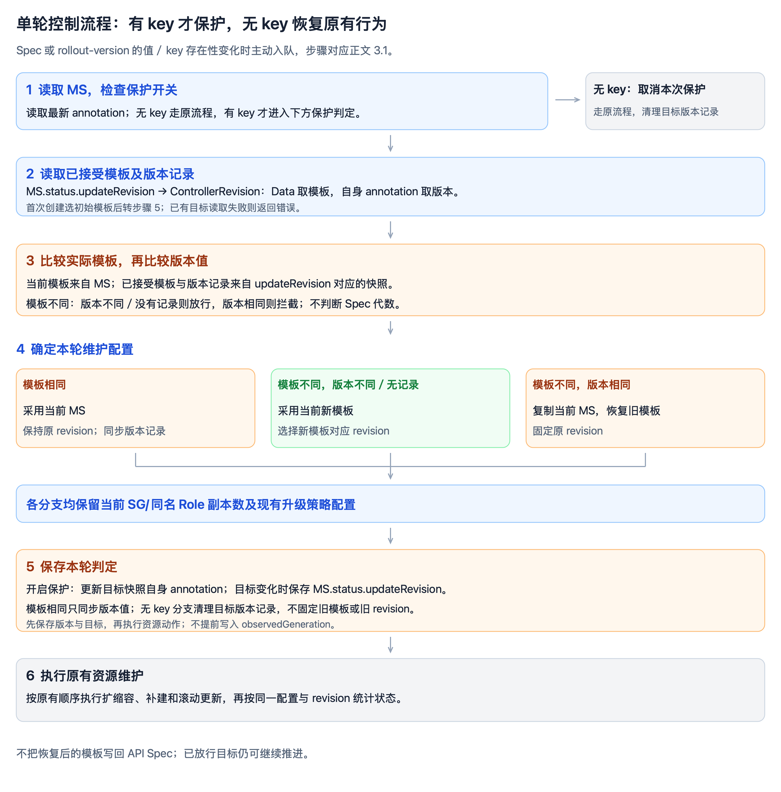
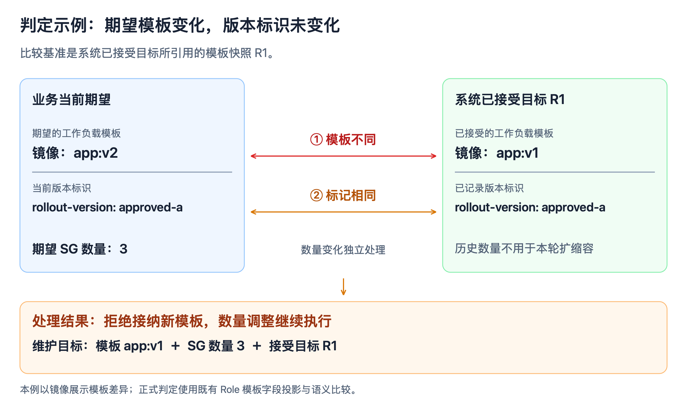

# ModelServing 滚动升级保护设计方案（评审稿）

实现基线：VanderChen/kthena 的 production/release-1.0，提交 cf918f17。

## 1. 背景与目标

ModelServing 的工作负载模板变化后，控制器会按既定策略推进升级。业务配置误改或自动化操作可能因此引发非预期的 Pod 更新。

本方案增加由业务控制的滚动保护：模板发生变化时，通过 rollout-version 判断是否允许采用新模板；未放行时继续使用原模板，SG 和同名 Role 的普通副本数量调整仍可执行。

## 2. 总体方案

业务在 ModelServing 顶层设置 annotation 开启保护，版本值由业务自行决定：

```yaml
metadata:
  annotations:
    modelserving.volcano.sh/rollout-version: "approved-a"
```

key 存在即开启，值为 "" 也有效；**key 不存在即取消本次保护，恢复原 controller 行为。** Spec 变化，或 rollout-version 的值、key 存在性变化，均主动触发 reconcile；其他 annotation 和纯 Status 更新不因此入队。控制器不再依赖后续 Pod 事件才处理版本变更。

例如，v2 被拦截后仅删除 key，本次更新主动入队，reconcile 退出保护，按原逻辑选择 MS 声明的 v2 并进入升级流程。实际资源动作继续受原有 partition、升级预算及故障恢复策略控制。

版本值的变化代表允许采用当前声明的模板，并主动触发 reconcile。例如，v2/A 被拦截后仅将版本值改为 B，控制器比较到 B 与快照记录的 A 不同，就放行 v2，无需再次修改 Spec。若模板未变，则只同步版本记录，不重建 Pod。首次开启保护且目标快照尚无版本记录时，也不拦截当前模板。

方案需要区分“业务现在提交的模板”和“控制器此前决定使用的模板”。例如，系统原先使用 v1，业务将 MS 中的镜像改为 v2，但没有改变版本值。本方案应让 API 中继续保留 v2 声明，而控制器仍按 v1 维护工作负载。因此本文定义：

- **当前模板**：当前 ModelServing 中声明的工作负载模板。上述例子中是 v2。
- **已接受模板**：控制器此前已确定用于创建或升级工作负载、并已保存到 ControllerRevision 的模板。上述例子中是 v1，通过 MS.status.updateRevision 找到它。

已接受模板不一定等于所有运行 Pod 的模板。v2 获准升级并保存目标后，已接受模板就变为 v2，即使仍有部分 v1 Pod 尚未完成更新。

保护开启时，每轮只比较当前模板与已接受模板、当前版本值与快照记录值，不使用 generation/observedGeneration 判断是否放行：

| 当前模板与已接受模板比较 | 当前版本值与已记录值比较 | 本轮处理 |
| --- | --- | --- |
| 相同 | 任意 | 使用当前 MS，保持原 revision；版本值不同时更新记录，不因此重建 Pod |
| 不同 | 相同 | 使用已接受模板，固定原 revision，拦截新模板 |
| 不同 | 不同，或尚无版本记录 | 使用当前新模板，保存新目标及版本值，按原有策略升级 |

**所有分支均使用当前 MS 的 SG/同名 Role 期望副本数。** 这里的数量指 ModelServing.spec.replicas 和同名 Role.replicas；Role 内部 workerReplicas 属于模板变化。

rolloutStrategy、maxUnavailable、maxSurge、partition 等原有升级策略也使用当前配置，继续决定升级粒度、方式、不可用预算和分区范围；这些配置不用于放行不同模板。

## 3. 详细设计

### 3.1 控制流程

Spec 更新、rollout-version 的值或 key 存在性变化均使 MS 入队；Pod 事件、重试和重启仍可独立触发 reconcile。其他 annotation 变化且 Spec 未变时直接跳过。流程图中的编号与以下步骤一致：

1. **读取 MS，检查保护开关。** 没有 key 时直接进入原有流程，本次保护不恢复旧模板、不固定旧 revision。有 key 时继续以下保护流程。
2. **读取已接受模板。** 根据 MS.status.updateRevision 找到 ControllerRevision，读取其中的模板及版本值。首次创建没有历史模板，按第 3.4 节确定初始模板后转步骤 5；已有目标的快照读取失败则返回错误。
3. **比较模板和版本值。** 模板相同则保持原 revision；模板不同且版本值不同，或快照尚无版本记录，则放行；模板不同且版本值相同则拦截。判定不依赖本轮由什么事件触发。
4. **确定本轮维护配置。** 模板相同或新模板获准时采用当前 MS；拦截时复制当前 MS，仅将模板字段恢复为快照模板，保留最新副本数，并固定原 revision。
5. **保存版本值和目标引用。** 更新 ControllerRevision annotation、MS.status.updateRevision。关闭保护时清理当前目标上的版本 annotation。记录失败则不进入新目标的后续正常扩容与升级。
6. **执行原有资源维护。** 使用上述配置和 revision 处理 SG/Role 数量、成员补建、滚动更新，并按同一目标统计状态。保护开启且拒绝模板时发出 RolloutBlocked Event。

本轮恢复模板只影响控制器使用的配置，不回写 API Spec。因此拦截不会取消副本调整，也不会把业务提交的新模板改回旧值。

**图 1：单轮控制流程** · [查看大图](images/rollout-guard/changes.png)



### 3.2 模板与版本值的比较

每轮从当前 MS 取得当前模板和版本值，再从 status.updateRevision 对应的 ControllerRevision 取得已接受模板和已记录版本值。**ControllerRevision.Data 提供模板，ControllerRevision 自身的 metadata.annotations 提供版本记录。** 不需要保留上一轮 MS，也不依赖 Update 事件中的旧对象。该分支的快照采用 Role 包装格式，可能带有历史 Role 副本数；恢复时只取模板字段，数量仍使用当前 MS。

比较的是实际模板内容，复用现有模板比较机制。镜像、命令、环境变量、资源及其他 Entry/Worker 模板输入参与比较；SG/Role 普通副本数、顶层 rollout-version 和升级策略不参与模板比较。revision 标识用于定位快照，不能仅凭名称或 hash 不同认定模板变化。该分支的 scheduler/plugin 由已有准入规则保持不可变，继续使用当前 MS 的配置，不加入本次 Role 模板判定。

例如，当前 MS 声明 app:v2、approved-a、SG=3，快照保存 app:v1、approved-a。两侧模板不同但版本值相同，后续使用 **app:v1、SG=3、原 revision**：新模板被拦截，数量调整继续执行。

**图 2：比较数据与拦截结果示例** · [查看大图](images/rollout-guard/comparison.png)



如果 API 中仍保留被拦截的 app:v2，本次只修改副本数，且版本值仍相同，则从快照恢复 app:v1，保留当前副本数。同名 Role.replicas 遵循相同规则。若本次只将版本值从 approved-a 改成 approved-b，则主动触发 reconcile，因版本值不同而放行 app:v2，并保存 v2/approved-b 的目标记录。

### 3.3 版本记录的保存与使用

下一轮需要知道“上一次使用这个模板时，版本值是什么”。该值不能只放在当前 MS 上，因为业务会修改它。因此，**本次新增将版本值写入 ControllerRevision 自身 annotation 的行为**，不把 ModelServing 顶层 annotation 嵌入模板 Data。

以已接受 v1/approved-a 为例，保存的数据为：

| Kubernetes 对象 | 保存内容 |
| --- | --- |
| ModelServing.status.updateRevision | 指向 v1 对应的 revision R1 |
| R1 对应的 ControllerRevision.Data | v1 模板 |
| 同一 ControllerRevision.metadata.annotations | rollout-version=approved-a |

后续根据请求分别处理：

- **拦截 v2/approved-a：**模板引用和版本值保持不变，下轮仍用 v1/approved-a 比较，不为被拦截的 v2 创建新快照。
- **放行 v2/approved-b：**创建或复用 v2 快照，先记录 approved-b，再将 MS.status.updateRevision 指向该目标。快照尚无版本记录时，按首次开启处理，允许采用当前模板。
- **仅改版本值：**本次 Update 主动入队。reconcile 时，若模板仍为 v1，仅更新 R1 自身的版本 annotation，不重建 Pod；若 MS 中留有被拦截的 v2，则因版本值改变而放行 v2。

这些写入不修改 MS.Spec，不新增字段，也不改变快照 Data 或模板 hash。保护逻辑不提前写入 observedGeneration，保留原有状态更新逻辑。后续状态写入沿用成功返回的资源版本。

### 3.4 开关变化与初始记录

| 场景 | 行为 |
| --- | --- |
| key 保持存在，仅修改版本值 | 主动触发 reconcile；模板不同时按新版本值放行，模板相同时只同步记录 |
| 首次新增 key，目标快照没有版本记录 | 主动触发 reconcile，首次开启不拦截当前模板 |
| 仅删除 key | 主动触发 reconcile，不再保护，恢复原有模板选择及资源维护逻辑 |
| 删除 key，同时修改 Spec | Spec 变化触发 reconcile，直接退出保护，按原有逻辑处理 |
| 完成关闭同步后重新新增 key，并提交新的 Spec | 当前目标记录已清理，按首次开启处理，不受旧值影响 |
| 真正首次创建，无历史模板 | 允许建立初始目标，并保存版本值及目标引用 |

没有 key 的 reconcile 只清理按原逻辑选出的本轮目标快照上的 rollout-version，其他历史数据保持原状。删除 key 会主动入队，在这轮处理时执行清理。清理记录不代表继续保护旧模板。空字符串是有效版本值，与没有 key 区分处理。

控制器以每轮观察到的最终声明和目标快照记录判断，不逐条重放 API 更新。如果多个更新在处理前被合并观察，则按本轮读取到的模板、开关和版本值处理。

### 3.5 对原有链路的改动

| 位置 | 改动 |
| --- | --- |
| 变更感知 | Spec 或 rollout-version 的值、key 存在性变化时入队；其他 annotation 及纯 Status 更新继续跳过 |
| 资源维护之前 | 有 key 时增加模板选择及版本记录同步；没有 key 则恢复原有行为 |
| 扩缩容、补建和升级 | 复用原有算法，使用选定模板、匹配 revision 及当前数量 |
| 状态统计 | 保留现有 UID/Generation 校验，再使用与执行阶段一致的配置及 revision |

原有 partition、surge、依赖限制、故障恢复和清理机制继续生效。已经发出的操作不因后续模板被拦截而撤销。

### 3.6 连续变更示例

初始使用 R1：模板 v1、版本值 approved-a、SG=2。先提交 v2/a 并被拦截，再仅将版本值改为 b 主动放行 v2，最后提交 v3/b：

**图 3：拦截、版本放行和再次拦截** · [查看大图](images/rollout-guard/example.png)


上述过程始终保持 key 存在。第一次拦截 v2/a 后，仅把版本值改成 b 就主动触发 reconcile，放行 v2，保存 R2/v2/b，无需等待 Pod 事件或再次修改 Spec。随后提交 v3/b，与已接受的 v2/b 比较后拦截 v3，已获准的 v2 升级仍可继续。若改为删除 key，也主动触发 reconcile，退出保护并按原有逻辑处理当前声明模板。

## 4. 重启恢复与异常处理

### 4.1 控制器重启

**普通控制器重启不会清除保护记录。** 模板和版本值保存在 ControllerRevision，目标引用保存在 MS.status；这些数据均持久化在 Kubernetes 中，不依赖控制器内存。重启后仍按当前 MS 与快照记录比较。

假设此前拦截了 v2/a，已保存 R1/v1/a。若 MS 的 key 和版本值 a 均未变化，重启后仍拦截 v2；若版本值已改为 b，但入队事件在重启前尚未处理，重启后的 reconcile 会因 b 与记录 a 不同而放行 v2；若 key 已删除但尚未处理，则重启后的 reconcile 退出保护，按原有逻辑处理。

重启发生在新模板记录写入过程中时：

| 重启前完成的写入 | 重启后的处理 |
| --- | --- |
| 只准备了新快照，尚未更新 MS.status.updateRevision | 仍以原目标比较，重新判断本次请求；候选快照存在不代表已经放行 |
| 已更新 MS.status.updateRevision，尚未完成 Pod 更新 | 从新目标恢复模板和版本值，继续已经放行的升级 |

缩到 0 再扩容也使用上述持久化记录，不需要通过现存 Pod 反推模板。

### 4.2 异常及已知边界

| 情况 | 处理原则 |
| --- | --- |
| 目标快照缺失、损坏、归属不符或比较失败 | 返回错误，不以当前新模板兜底；尝试既有安全缩容 |
| 版本记录或目标引用保存失败 | 不进入新目标的后续正常扩容、升级；重试时重新读取已保存的记录 |
| 并发修改导致状态冲突 | 后续完整 reconcile 重新判断，本轮状态更新可能延后 |

安全缩容仍受原有策略限制，异常时不保证所有数量调整都能执行。快照与 MS 状态的写入不是跨资源事务。

**持久化状态被清空与控制器重启不同。** 当前实现以 updateRevision、currentRevision 均为空且 observedGeneration 为 0 识别初始化；存量资源若这些状态全部丢失，可能被误判为首次创建，进而接受不同模板。该场景尚未覆盖，属于当前方案的已知缺口。其他有处理痕迹但目标引用缺失的情况按异常处理。

## 5. 验证与验收

| 验证项 | 验收要求 |
| --- | --- |
| 三条主判定规则 | 分别叠加 SG/Role 数量变化，模板与数量目标符合第 2 节约定 |
| 拦截后只改数量 | API 中保留未放行模板时，继续使用快照模板处理数量变化 |
| 仅 annotation 更新 | rollout-version 的新增、修改、删除主动入队；模板相同不重建 Pod，模板不同则按版本判断；其他 annotation 变化不入队 |
| 开关与版本值 | 覆盖首次新增 key 不拦截、删除 key 主动退出保护、关闭清理、重新开启、空字符串与缺少 key 的区别 |
| 升级途中再次变更 | 与最新已接受模板比较，拒绝未放行模板，原有升级可继续 |
| 控制器重启 | 版本未变仍拦截；版本变化则放行遗留模板；已放行目标继续执行；写入中断按第 4.1 节恢复 |
| 错误处理 | 快照异常、记录写入失败和状态冲突不放行未经允许的模板 |

验证覆盖 SG/Role 两种滚动粒度及现有重建升级方式。已新增滚动保护专项 UT，覆盖事件入队、模板及版本判定、副本数和策略保留、快照异常、持久化失败及重试、上下文及状态一致性，以及两种粒度下的扩缩容和补建。专项 60 个场景与 model-serving-controller 相关包回归均已通过；集群验收结果另见 Alpha 验证报告。
